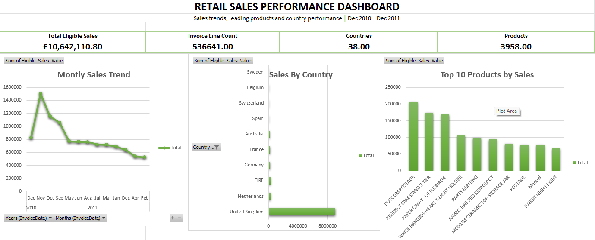

# Retail Sales Performance Dashboard | Microsoft Excel

## Project Overview

This project analyzes historical online retail transactions using Microsoft Excel to identify monthly sales patterns, leading countries, and top-selling products.

The workbook includes data-quality checks, calculated sales metrics, PivotTables, a dashboard, and evidence-based business insights.

## Project Files

- [Download the Excel Workbook](https://drive.google.com/uc?export=download&id=1YHDB3kgVDnI7H0VJNv74_7SJdsRvPIme)
- [Download Dashboard Preview](retail-sales-dashboard.png).
- .

## Business Questions

- How did eligible sales vary by month?
- Which countries contributed the most to eligible sales?
- Which products generated the highest eligible sales?
- What business opportunities and limitations can be identified?

## Tools and Skills

- Microsoft Excel
- Data cleaning and quality checks
- Excel formulas and calculated columns
- Excel Tables and PivotTables
- Sorting, filtering, and Top 10 analysis
- KPI cards and charts
- Business analysis and communication of findings

## Dataset

**Source:** [UCI Machine Learning Repository — Online Retail](https://archive.ics.uci.edu/dataset/352/online-retail)

- Original dataset: 541,909 transaction rows
- Period: 1 December 2010 to 9 December 2011
- Countries in the cleaned workbook: 38
- Product codes in the cleaned workbook: 3,958

The dataset contains invoice numbers, product codes, descriptions, quantities, invoice dates, unit prices, customer IDs, and countries.

## Data Preparation

The original data is preserved in `Raw_Data`. The `Clean_Data` worksheet contains the working data and calculated fields.

Preparation included:
1. Checking missing customer IDs and product descriptions.
2. Checking negative quantities and nonpositive unit prices.
3. Flagging cancellation invoice lines.
4. Auditing exact duplicate rows.
5. Creating calculated fields for sales analysis.
6. Documenting findings and decisions in `Data_Quality_Log`.

Excel identified and removed 5,268 rows matching across the selected columns, leaving 536,641 rows in the cleaned working data.

**Important:** Identical rows are not necessarily accidental duplicates. The original dataset was preserved for reference.

## Calculated Fields

- `Line_Value_Raw`: Quantity × Unit Price
- `Cancellation_Flag`: Flags invoice numbers beginning with `C`
- `Return_Flag`: Flags negative quantities
- `Eligible_Sales_Value`: Includes rows with positive quantity, positive unit price, and invoice numbers not beginning with `C`

The eligible sales formula is:

`=IF(AND(D2>0,F2>0,LEFT(A2,1)<>"C"),D2*F2,0)`

This is a filtered positive-sales measure, not net revenue, profit, or profit margin.

## Dashboard KPIs

| KPI | Result |
|---|---:|
| Total eligible sales | £10,642,110.80 |
| Cleaned invoice lines | 536,641 |
| Countries | 38 |
| Product codes | 3,958 |

## Key Findings

### 1. Monthly Sales

- Highest: November 2011 — £1,503,866.78
- Lowest: February 2011 — £522,545.56
- Difference: £981,321.22
- November's eligible sales were approximately 187.80% higher than February's.

**Interpretation:** Monthly sales varied substantially. Further investigation is needed to establish the causes.

### 2. Country Contribution

- Top 10 countries' eligible sales: £10,345,278.86
- Share of total eligible sales: 97.21%

**Interpretation:** Eligible sales were highly concentrated among the top 10 countries in this dataset.

### 3. Product Contribution

- Top 10 products' eligible sales: £1,153,142.32
- Share of total eligible sales: 10.84%

**Interpretation:** The top 10 products represented a relatively small share of total eligible sales, with sales distributed across a broader product range.

## Workbook Structure

- `Raw_Data` — original source data
- `Clean_Data` — working data and calculated fields
- `Data_Quality_Log` — quality checks and decisions
- `Duplicate_Audit` — duplicate-removal audit
- `Analysis` — PivotTables and supporting calculations
- `Dashboard` — KPI cards and charts
- `Business_Insights` — findings, recommendations, and executive summary

## Limitations

- The dataset is historical and does not represent current retail performance.
- Eligible sales exclude cancellation invoices, nonpositive quantities, and nonpositive unit prices.
- Negative quantities may represent returns or adjustments; their exact meaning cannot be confirmed from quantity alone.
- Missing customer IDs limit customer-level analysis for affected records.
- Duplicate removal was based on matching values across selected columns; matching rows are not necessarily accidental duplicates.
- Product costs are not available, so profit and profit margin cannot be calculated.
- The analysis identifies patterns but does not establish causes or prove causal relationships.

## Next Steps

- Investigate monthly sales patterns and product demand.
- Explore customer behavior where customer IDs are available.
- Analyze country-level performance in more detail.
- Extend the analysis with additional data and business context.

## Project Purpose

This independent portfolio project demonstrates foundational Excel data-analysis skills, data-quality awareness, analytical reasoning, and communication of business findings.

